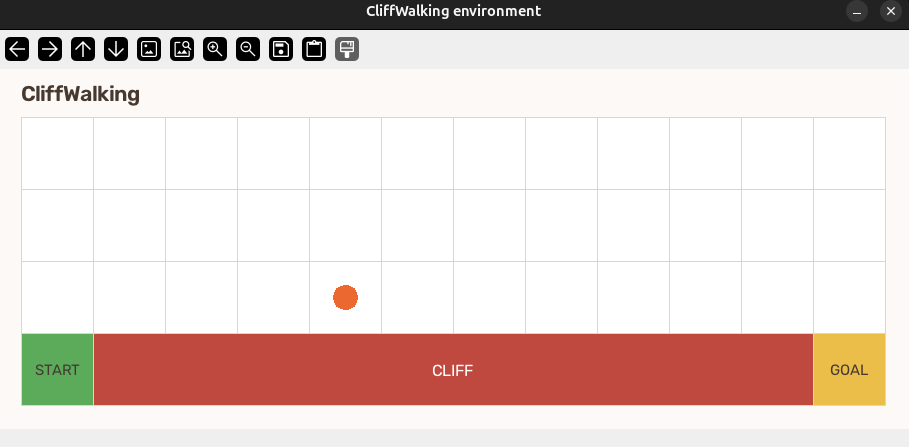

<div align="center">



<h1 align="center" >


<b>Cliff Walking with Q-learning</b>


</h1>

[](https://github.com/vividblueprint)
[](https://github.com/vividblueprint/cliffwalking_vanilla_rl/issues)
[](https://github.com/vividblueprint/cliffwalking_vanilla_rl/pulls)
[](https://github.com/vividblueprint/cliffwalking_vanilla_rl/graphs/contributors)
[](https://github.com/vividblueprint/cliffwalking_vanilla_rl/stargazers)
[](https://github.com/vividblueprint/cliffwalking_vanilla_rl/forks)
[](https://github.com/vividblueprint/cliffwalking_vanilla_rl/watchers)
[](https://github.com/vividblueprint/cliffwalking_vanilla_rl/commits)
[](https://github.com/vividblueprint/cliffwalking_vanilla_rl/commits)
[](https://github.com/vividblueprint/cliffwalking_vanilla_rl)
[](https://github.com/vividblueprint/cliffwalking_vanilla_rl)
[](https://github.com/vividblueprint/cliffwalking_vanilla_rl)
[](https://github.com/vividblueprint/cliffwalking_vanilla_rl/commits)
[](https://github.com/vividblueprint/cliffwalking_vanilla_rl/tree/HEAD)
[](https://github.com/vividblueprint/cliffwalking_vanilla_rl/blob/HEAD/LICENSE)

</div>

---

## Run

Install dependencies and train:

```bash
uv sync
uv run train.py --episodes 500
```

The agent starts at the bottom-left, reaches the goal at the bottom-right, and receives a large penalty if it steps into the cliff. Training saves `q_table.npy` and `policy.png` under `runs/cliffwalk/`.

Show the learned policy in a window:

```bash
uv run train.py --show
```

Display a random-action episode in the custom CliffWalking environment:

```bash
uv run test_env.py
```

Run the trained greedy policy in the environment window:

```bash
uv run play.py
```

Pass a Q-table path explicitly if it is saved elsewhere:

```bash
uv run play.py runs/cliffwalk/q_table.npy
```

Useful options are `--rows`, `--cols`, `--alpha`, `--gamma`, `--epsilon`, `--seed`, and `--out`. Actions are `0=up`, `1=right`, `2=down`, and `3=left`.

## Compare tabular agents

`src/cliffwalk/agent_multi.py` includes Q-learning, Double Q-learning, Expected SARSA, SARSA, SARSA(lambda), and first-visit Monte Carlo control. Select an agent by name:

```python
from cliffwalk import make_agent

agent = make_agent("double_q", n_states=env.n_states, n_actions=env.n_actions)
```

The training script supports the same algorithms with `--agent`:

```bash
uv run train.py --agent sarsa --episodes 500
uv run train.py --agent monte_carlo --episodes 500
```

For SARSA and SARSA(lambda), choose the next action before updating, then pass it as `next_action` to `learn`. Monte Carlo control updates at episode end; pass `done=True` on the final transition.

## Files

- `src/cliffwalk/env.py` — grid and step rules
- `src/cliffwalk/agent.py` — epsilon-greedy Q-learning
- `src/cliffwalk/agent_multi.py` — additional tabular control algorithms
- `src/cliffwalk/visualize.py` — simple board and policy drawing
- `train.py` — training loop and output files
